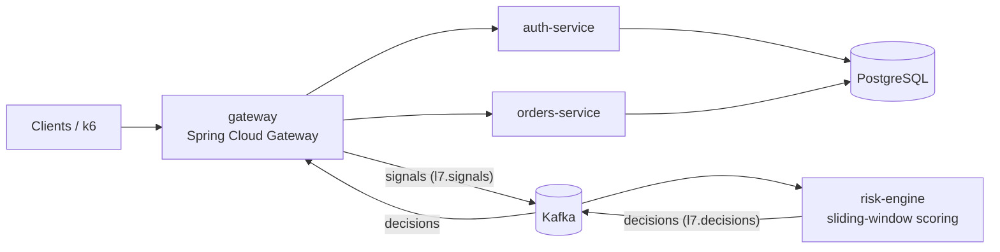

# L7 Adaptive Defense

Identity-aware, adaptive defence against application-layer (L7) DoS attacks in a microservice system. MSc dissertation at Swansea University (2026), presented at the Computational Foundry MSc Conference.

<!-- After the first green CI run, uncomment the badge:
[](https://github.com/berkkaradas/l7-adaptive-defense/actions/workflows/ci.yml)
-->

## The problem

Firewalls and API gateways only see traffic from the outside. That leaves two blind spots:

- **Slow attacks.** A brute-force attack that stays under the rate threshold never trips the limiter.
- **Shared IPs.** Many users can sit behind one address (office NAT, mobile carrier). Blocking the IP blocks all of them.

This project closes both gaps. It also watches what happens inside the services (failed logins, 5xx errors, latency), scores each *identity* instead of each IP, and responds step by step (rate limit, then tarpit, then drop) instead of blocking outright.

## Architecture



- **gateway**: resolves the identity of each request, checks its cached decision, enforces mitigation, publishes signals to Kafka and consumes decisions back
- **auth-service**: registration and login, issues JWTs
- **orders-service**: the business service being protected
- **risk-engine**: consumes signals, scores each identity over a sliding window, publishes decisions

## Key design decisions

- **Scoring stays off the request path.** The gateway publishes signals to Kafka and reads decisions back into a Caffeine cache, so a normal request never waits for scoring.
- **Identity, not IP.** Authenticated requests are keyed by the JWT subject (`AUTH:<id>`). Login attempts are keyed by IP plus the attempted username (`ATTEMPT:<ip>,<username>`). One attacker behind a NAT does not take everyone else down.
- **Graduated response.** Rate limit, then tarpit, then drop (Bucket4j), instead of a hard block on the first signal.
- **An outage is not an attack.** When a backend service fails, 5xx errors describe the system, not the user. An identity is only blamed when its share of the errors clearly stands out.

## Results

40 k6 runs: 4 scenarios × 2 conditions × 5 repeats, all valid. *Baseline* is the static rate limiter alone (`docker compose stop risk-engine`); *adaptive* is the full loop. Values are medians across the 5 repeats.

| Scenario | What it tests | Baseline | Adaptive |
| --- | --- | --- | --- |
| S1 Normal traffic | Latency overhead | 8.9 ms median latency | 7.1 ms median latency |
| S2 Low-and-slow brute force | Detection | Attacker caught in 0/5 runs | Caught in 5/5 runs, median 8.0 s |
| S3 Attacker and innocent users behind one IP | Collateral damage | Attacker caught in 0/5 runs | Caught in 5/5 runs; 0% of innocent users' requests refused |
| S4 Internal degradation (orders-service down) | Blame during an outage | Attacker caught in 0/5 runs | Caught in 5/5 runs, median 2.0 s |

Scoring runs off the request path, so the gateway kept serving requests through an 89-second Kafka outage.

Trade-offs the runs show:

- **S3:** the attacker targets a real user's username from the shared IP, so that user's own logins from the same IP were refused about 16% of the time.
- **S4:** in each run, one of the five legitimate users was also penalised while the backend was failing (false positive rate 0.2).

Raw data for every run is in `runs/`; the scripts in `analysis/` recompute all metrics from it.

## Stack

Java 21, Spring Boot 4 (WebFlux for the gateway, MVC with virtual threads for the services), Spring Cloud Gateway, Kafka (KRaft), PostgreSQL, Caffeine, Bucket4j, k6, Docker Compose.

## Running it

```bash
docker compose up -d
```

Clients only talk to the gateway (8080). PostgreSQL (5432) and Kafka (29092) are also published on the host for local debugging and for the run scripts.

```bash
curl -X POST localhost:8080/auth/register -H "Content-Type: application/json" -d '{"username":"alice","password":"CorrectHorseBattery1"}'
curl -X POST localhost:8080/auth/login    -H "Content-Type: application/json" -d '{"username":"alice","password":"CorrectHorseBattery1"}'
curl localhost:8080/items -H "Authorization: Bearer <token>"
```

## Reproducing the evaluation

Needs [k6](https://k6.io).

```powershell
.\scripts\run_matrix.ps1                     # full 40-run matrix, about 4.5 h
.\scripts\run_matrix.ps1 -Repeats 1 -Smoke   # 8 quick runs to sanity-check the pipeline
python analysis\aggregate_matrix.py          # writes the summary tables to analysis/out/
```

## Tests

```bash
mvn -pl risk-engine test
```

Unit tests focus on the scoring and decision logic in risk-engine, where a silent bug is most dangerous. The gateway filters and the Kafka pipeline are exercised end to end by every one of the 40 runs.

A plain `mvn test` also runs the Spring context tests. The gateway's context test needs a live Kafka (`docker compose up -d kafka` first).

## Notes

Credentials in `docker-compose.yml` are development values, committed on purpose so the whole system runs with one command. All evaluation traffic is synthetic.
